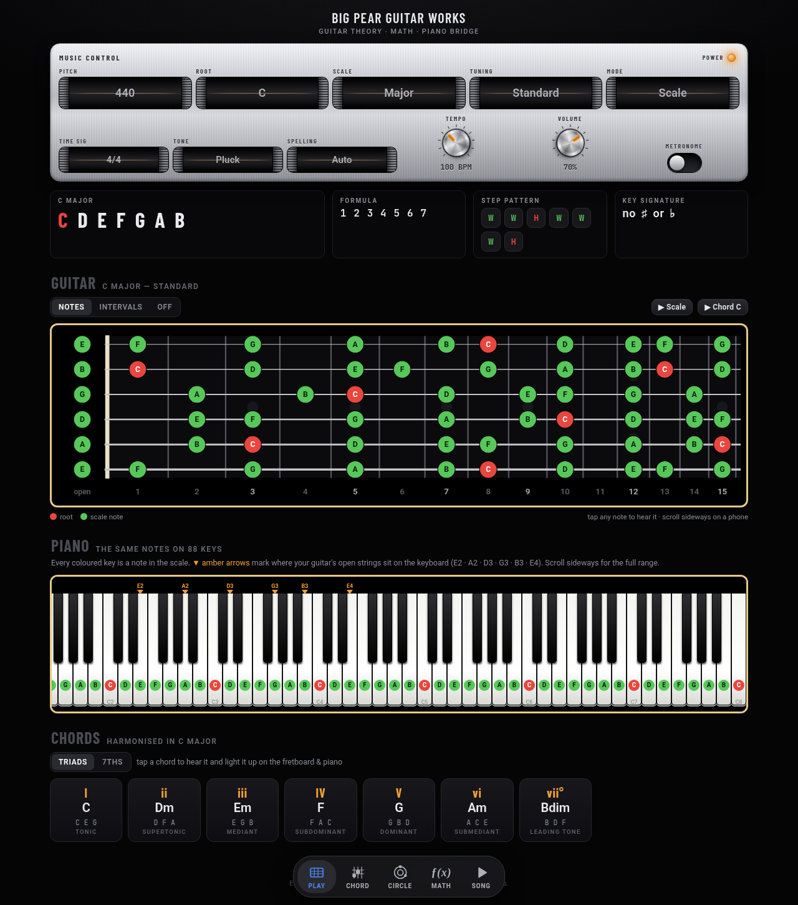
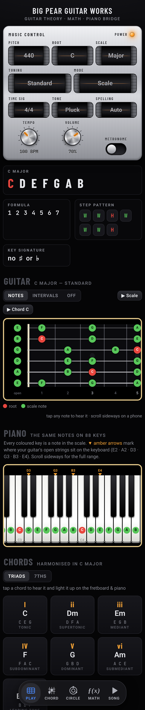

# 🍐 Big Pear Guitar Works

**A guitar theory tutorial that shows the math under every note — and bridges the fretboard to the piano.**

### ▶ Live app: **https://berkley444.github.io/One/**

*(Single file, no install, works on a phone. If the link 404s, GitHub Pages isn't switched on yet: Settings → Pages → Deploy from branch → `main` / root.)*



<p align="center"></p>

## What's in it

| Tab | What it shows |
|---|---|
| **PLAY** | Pick a root, scale/mode and tuning on the brushed-metal panel. See the notes, formula, W/H step pattern and key signature; the same notes on a 0–15-fret fretboard **and** an 88-key piano; the harmonised chords with roman numerals. **Position buttons** (All, 1–7 modes or 1–5 boxes) sit in one row just above the fretboard and isolate one box of the scale with finger suggestions. Tap anything to hear it. |
| **CHORD** | The fretboard comes first, with one row above it: the 12 roots and the position buttons. Below it, the Chord Builder: 51 chord qualities (one-tap grid). Formula, notes, intervals, and **six generated guitar positions** (buttons 1–6, numbered-finger diagrams, strum/arpeggio) for the current tuning, with the same voicing on the piano. |
| **CIRCLE** | Interactive circle of fifths — tap a key to set it; relative minor, key signature, neighbours, and "walk the circle". |
| **ƒ(x) MATH** | `f(n) = 440 × 2^(n/12)` with `n` worked out step by step; every note of the scale vs. just intonation; open strings; fret-by-fret frequencies. |
| **SONG** | Time signature + tempo + metronome, and a **Generate progression** button: 4–8 bars in the key, played back. |

### Clear it and name your chord

On the fretboard toolbar, **✎ Clear / Identify** wipes the board so you can place notes yourself: tap a fret to place a note (one per string, tap again to remove), tap the left column to cycle open ○ / muted ×. The app names the chord as you go (root, quality, bass, inversion, other names, interval for two notes), shows note names and intervals on the dots, and can show it on the piano. **? Chord Quiz** gives you a chord name and grades what you place (missing / extra notes explained, score and streak saved). The lock icon in the header turns on an optional *chord unlock* pop-up (**just for fun, not security**, off by default).

Controls: the 12 **root buttons** (above the board on PLAY and CHORD, and in a Root + Scale bar on CIRCLE / MATH / SONG) set the one shared root. In the fretboard toolbar: Notes / Intervals / Fingers / Off, then the **scale** select (major, natural/harmonic/melodic minor, major/minor pentatonic, blues, 5 more modes), the **Chord | Scale** toggle and Clear / Identify. A small **tuning** select (standard, drop D, DADGAD, open G/D/E, half-step down, full-step down, 7-string, bass) sits at the top-left of the board. The **Music Control** panel at the very bottom of the page holds `PITCH` (A4 415–450) · `TIME SIG` · `TONE` · tempo and volume knobs · metronome switch · power.

## Themes

The look is a setting: tap the **theme button** (top right of the header) or add `?theme=<id>` to the URL. The choice is remembered. **Minimal Light** is the default; **Silver Hi-Fi** (the original brushed-metal look) is one tap away.

| Theme | Link | Look |
|---|---|---|
| Silver Hi-Fi (the original) | [`?theme=silver`](https://berkley444.github.io/One/?theme=silver) | brushed aluminium, 1970s home stereo |
| Studio Console | [`?theme=console`](https://berkley444.github.io/One/?theme=console) | charcoal mixing desk, coloured channel-strip caps, live LED level meter |
| Boutique Pedal | [`?theme=pedal`](https://berkley444.github.io/One/?theme=pedal) | teal enamel stompbox, chicken-head knobs, jewel lamp |
| Tube Amp | [`?theme=tube`](https://berkley444.github.io/One/?theme=tube) | black tolex, gold plate, cream chicken-head knobs, grille cloth |
| Minimal Light (default) | [`?theme=minimal`](https://berkley444.github.io/One/?theme=minimal) | flat iOS-style, segmented controls and steppers |
| Minimal Dark | [`?theme=minimal-dark`](https://berkley444.github.io/One/?theme=minimal-dark) | the same on true black |
| Navy Light | [`?theme=navy-light`](https://berkley444.github.io/One/?theme=navy-light) | Minimal Light in blue and white: navy `#000055` text, cobalt accents |
| Modular Synth | [`?theme=synth`](https://berkley444.github.io/One/?theme=synth) | Eurorack panels, small knobs, patch jacks, mono labels, LED meter |
| Vintage Wood | [`?theme=wood`](https://berkley444.github.io/One/?theme=wood) | walnut cabinet, brass knobs, paper label tags |
| Sunburst | [`?theme=sunburst`](https://berkley444.github.io/One/?theme=sunburst) | honey-to-cherry lacquer panels, cream binding, gold top-hat knobs, rosewood neck |
| Surf Green | [`?theme=surf`](https://berkley444.github.io/One/?theme=surf) | seafoam lacquer and chrome, cream pickguard cards, maple neck with black dots |
| Rosewood & Pearl | [`?theme=rosewood`](https://berkley444.github.io/One/?theme=rosewood) | dark rosewood, pearl window drums and inlays, aqua highlights |
| Sheet Music | [`?theme=sheet`](https://berkley444.github.io/One/?theme=sheet) | cream manuscript paper, black ink, oxblood accents, serif type |

Side by side: [PLAY](docs/screenshots/themes_play.png) · [CHORD](docs/screenshots/themes_chord.png) · [LEARN on a phone](docs/screenshots/themes_learn_phone.png).

Themes are plain CSS in [`themes/`](themes/README.md), pasted into `index.html` by `node tools/build-themes.js`. `node tools/theme-shots.js` and `node tools/contact-sheet.js` make the comparison screenshots.

## Run it

Open `index.html` in a browser. That's it. No build step, no dependencies (fonts are optional via CDN).

```bash
node tests/theory.test.js     # theory + math tests (spelling, key signatures, chords, frequencies, voicings, progressions)
```

## Repository layout

```
index.html                     the entire app (HTML + CSS + JS; theory lives in a <THEORY> block)
manifest.webmanifest, sw.js    installable-app manifest and offline service worker
icons/                         app icons (svg + png, maskable, apple-touch)
themes/                        theme CSS (one file per theme) + art; tools/ builds and screenshots them
tests/browser/                 headless-Chrome tests (smoke, practice, song, lessons, identify/quiz/unlock, PWA/offline, axe, themes) - see its README
tests/theory.test.js           node tests; extracts the <THEORY> block from index.html
.nojekyll                      serve as plain static files on GitHub Pages
docs/
  SPEC.md                      the vision, in his words
  DECISIONS.md                 dated decision log
  REBUILD_POSTMORTEM.md        why the rebuild lost the look, and how to avoid it
  NEXT.md                      done / next / pinned ideas
  HOW_TO_WORK_WITH_AGENTS.md   the recipe: read docs → small slices → mockup → build → review
  screenshots/                 original app, the rebuild, and the web version
  research/                    piano-teaching market research + build prompt (md + pdf)
```

## Status

The web app is complete and tested. **The Mac/Xcode project — the real app — still needs to be added to this repo** (first item in [`docs/NEXT.md`](docs/NEXT.md)).

---
*Equal temperament: f(n) = A4 × 2^(n/12). No tracking, no accounts.*
